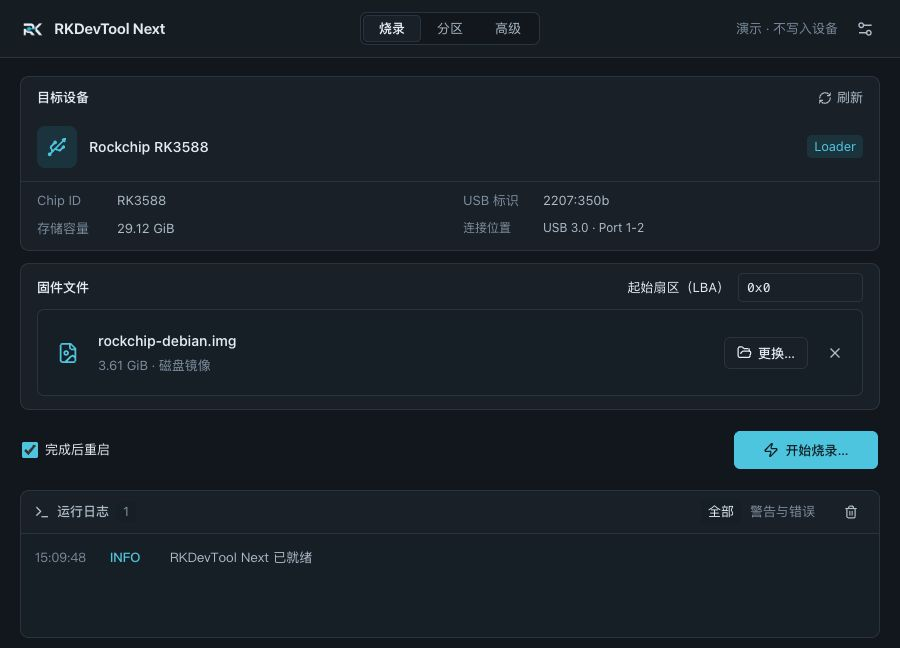
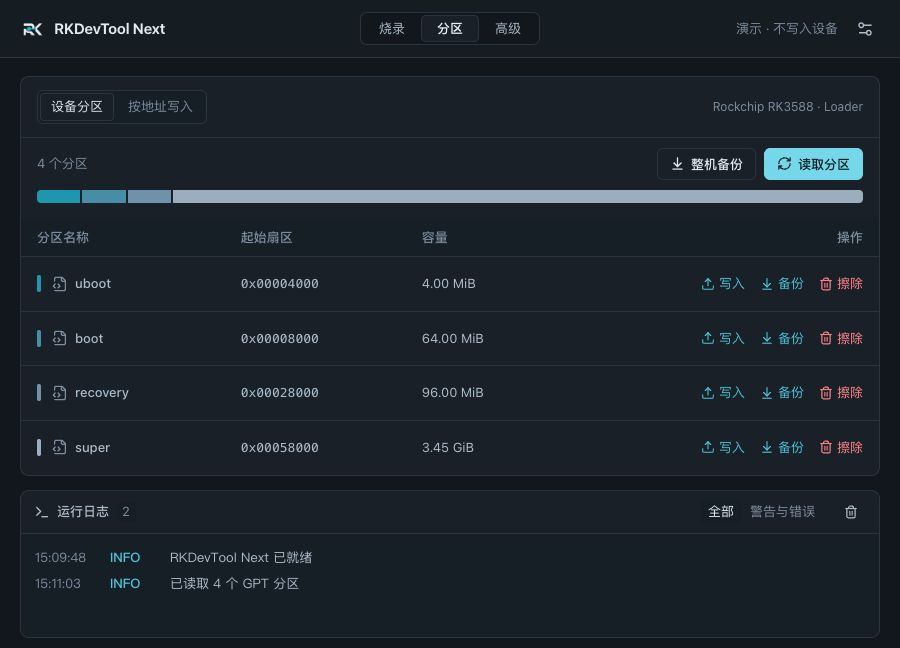
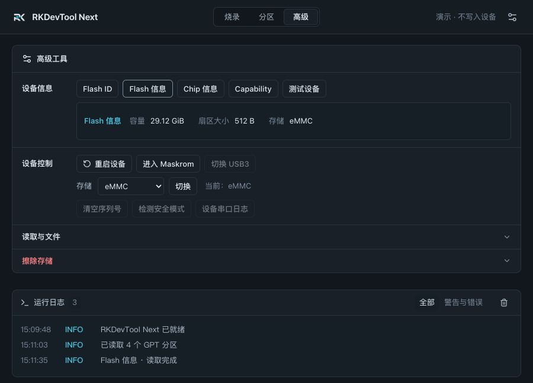

<p align="center">
  
</p>

<h1 align="center">RKDevTool Next</h1>

<p align="center">面向 Rockchip 开发板的原生烧录工作台</p>
<p align="center">
  <a href="https://github.com/FantasyGmm/rkdevtool-next/releases/latest">下载安装包</a> ·
  <a href="https://github.com/FantasyGmm/rkdevtool-next/actions/workflows/desktop-build.yml">构建状态</a> ·
  <a href="https://github.com/FantasyGmm/rkdevtool-next/issues">反馈问题</a>
</p>

RKDevTool Next 是社区维护的跨平台 Rockchip 烧录工具，使用 **Tauri 2 + React / TypeScript + Rust**，将固件选择、Loader 下载、分区管理和运行日志整合到一个桌面窗口中。USB 通信和固件处理在本机完成，运行时不依赖 Python、Qt 或外部 `rkdeveloptool`。

## 界面预览

深色主题 · 演示数据

### 烧录



### 分区



### 高级工具



## 下载与安装

到 [Releases](https://github.com/FantasyGmm/rkdevtool-next/releases) 下载与你的电脑匹配的安装包：

| 平台 | 文件 | 安装方式 |
| --- | --- | --- |
| macOS Apple Silicon（M 系列，macOS 11+） | `RKDevTool-Next_*_macos-arm64.dmg` | 打开 DMG，将 RKDevTool Next 拖入「应用程序」 |
| Windows x64（Windows 10 / 11） | `RKDevTool-Next_*_windows-x64-setup.exe` | 运行安装程序；按提示安装 WebView2 运行时 |

macOS 使用无需证书的 ad-hoc 本地签名，未配置 Apple Developer 签名或公证；Windows 安装包未配置代码签名。系统可能显示安全提示，请确认安装包来自本仓库的 Release。

**Windows USB 驱动：** 原生后端需要目标 **Rockusb 接口使用 WinUSB**。Rockchip 专有驱动不等同于 WinUSB。修改驱动前记录原驱动，并只选择开发板对应的 USB 接口，避免改动其他设备。

## 开始烧录

1. 按开发板文档进入 **Maskrom / Loader**，将 USB 数据线接到板卡的 OTG / Device 接口。
2. 如果显示 **Maskrom**，点击「加载 Loader」，选择厂商提供、与芯片和存储匹配的 Loader。此步骤只将 Loader 下载到 RAM。
3. 等待设备重新连接。进入 **Loader** 后，设备详情会自动刷新芯片信息和存储容量。
4. 选择固件，核对设备与写入范围。整包固件在「烧录」页处理；单个分区镜像可在「分区」页选择目标分区写入；RAW 镜像也可按指定 LBA 写入。
5. 选择是否「完成后重启」，确认后开始烧录。

**写入和擦除会覆盖设备数据。** 先备份重要内容，并保持稳定供电。停止任务在数据块边界生效，已写入或擦除的数据不会回滚。一次只连接一台待操作设备。

## 主要功能

- **设备识别**：自动扫描 USB、区分 Maskrom / Loader、Loader 下载后同端口重连与协议握手。
- **芯片与存储信息**：显示原始 Chip ID、已识别的芯片型号、容量、Flash 信息与 Loader 能力。未知 Chip ID 保留原始值，不通过 USB PID 猜型号。
- **固件烧录**：RKFW / RKAF 容器解析、RAW 镜像、写入范围检查及固件 CRC 校验。
- **分区管理**：读取 GPT、分区写入、分区备份与擦除、整机备份、按地址写入。
- **高级工具**：读取设备信息、重启、进入 Maskrom、切换存储、按扇区 / 分区 / 全部存储擦除。
- **本地文件处理**：原生解包 RKFW / RKAF；支持 ZIP、gzip、xz、bzip2 压缩镜像处理。
- **操作反馈**：串行任务、实时进度、日志筛选与导出；向上翻阅日志时暂停自动跟随，回到底部后继续跟随。
- **界面**：浅色 / 深色 / 跟随系统外观，固定导航，独立滚动的分区列表和日志区域。

## 适用范围

- Loader 和固件必须与实际开发板匹配；不支持受保护或签名 Loader 的通用下载流程。
- RKFW 整包写入面向能确定 IDB / GPT 布局的 **eMMC / SD**。加密、NAND 或无法安全规划的布局会被拒绝；不要将 RKFW 容器强行作为 RAW 写入。
- 分区管理以 **GPT** 为基础，不猜测未知分区表或烧录地址。较小 GPT 整盘镜像写入较大设备后的备份 GPT 迁移、按分区操作的实时 GPT 身份复核仍需完善；操作前核对布局，避免在外部工具改表后沿用旧列表。
- 压缩文件支持 ZIP / gzip / xz / bzip2；不支持 7z、zstd、tar。
- USB3 切换、清空序列号、安全模式检测和设备串口日志暂未开放。
- Windows 的构建与打包由 CI 完成，真机 USB 通信仍需在对应 Windows 电脑和板卡上验证。当前 macOS 真机调试使用 RK3576；其他板卡请以实际兼容性为准。

## 从源码运行

准备 **Node.js 24 LTS、Rust stable** 及 [Tauri 平台构建依赖](https://v2.tauri.app/start/prerequisites/)：

- macOS：Xcode Command Line Tools。
- Windows：Visual Studio C++ Build Tools、Windows SDK、WebView2。
- Linux：WebKitGTK 4.1 等原生依赖；当前 Release 不提供 Linux 安装包。

```bash
git clone https://github.com/FantasyGmm/rkdevtool-next.git
cd rkdevtool-next
npm ci --ignore-scripts
npm run desktop
```

生成当前平台的安装包：

```bash
npm run check:version
npm run tauri -- build --ci -- --locked
```

产物位于 `src-tauri/target/release/bundle/`。显式指定 `--target` 时，位于对应 target 子目录。macOS 默认生成 `.app` / `.dmg`，Windows 生成 NSIS `.exe`。

仅预览界面可运行 `npm run dev`，打开 `http://localhost:1420/`。加上 `?demo=1` 可进入标注为演示的交互模式，不访问 USB；真实烧录请使用桌面应用。

Linux 源码构建需安装 WebKitGTK 4.1、OpenSSL、AppIndicator、librsvg、patchelf 等依赖。USB 权限应通过发行版的 udev 规则配置，不建议以 root 运行整个桌面应用。

## 自动构建与发布

[GitHub Actions 工作流](.github/workflows/desktop-build.yml) 使用 GitHub-hosted runner：

- 推送 `main`、提交 Pull Request，或手动运行：构建 **macOS arm64 / Windows x64**，安装包保存为 Actions artifacts。
- 推送 `v*` 标签：校验标签与源码版本一致，构建两个平台；全部成功后，将两个安装包上传并发布到 GitHub Release。
- 任一平台失败：不发布新的 Release。上传失败时保留草稿，可修复流水线后重跑；已发布的版本不覆盖，后续修改使用新版本号。

发布新版本时，同步修改以下版本号并提交：

```text
package.json
package-lock.json（顶层与根 package）
src-tauri/Cargo.toml
src-tauri/Cargo.lock（rkdevtool-next package）
src-tauri/tauri.conf.json
```

然后推送对应标签，例如：

```bash
npm run check:version
git tag v0.1.6
git push origin main v0.1.6
```

工作流使用仓库内置的 `GITHUB_TOKEN` 发布，无需额外保存 GitHub PAT、Apple 证书或签名密钥。构建不连接开发板，也不执行烧录或擦除。

## 代码结构

```text
src/                    React 界面、Tauri 桥接、共享类型
src-tauri/src/          USB、Loader、固件、GPT 与任务执行
src-tauri/icons/        平台应用图标
public/                 界面品牌资源
assets/                 图标源图与生成说明
scripts/                本机构建与版本一致性检查
.github/workflows/      跨平台构建与 Release 发布
```

## 致谢与许可证

特别感谢 **[gahingwoo / RKDevelopTool-GUI](https://github.com/gahingwoo/RKDevelopTool-GUI)**。RKDevTool Next 的烧录工作流、固件处理与交互组织参考了该项目，并以 Tauri / Rust 实现原生桌面版本。

同时感谢 [rockchip-linux/rkdeveloptool](https://github.com/rockchip-linux/rkdeveloptool)、[rockchip-linux/u-boot](https://github.com/rockchip-linux/u-boot)、[Collabora rockchiprs（rockusb / rockfile）](https://github.com/collabora/rockchiprs)、[nusb](https://github.com/kevinmehall/nusb) 和 [Tauri](https://github.com/tauri-apps/tauri) 等开源项目。各项目在本项目中的用途见 [致谢](ACKNOWLEDGEMENTS.md)。

本项目采用 **GPL-3.0-only**，见 [LICENSE](LICENSE)。第三方依赖保留各自许可证。
